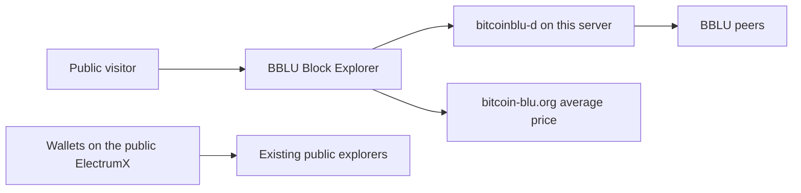
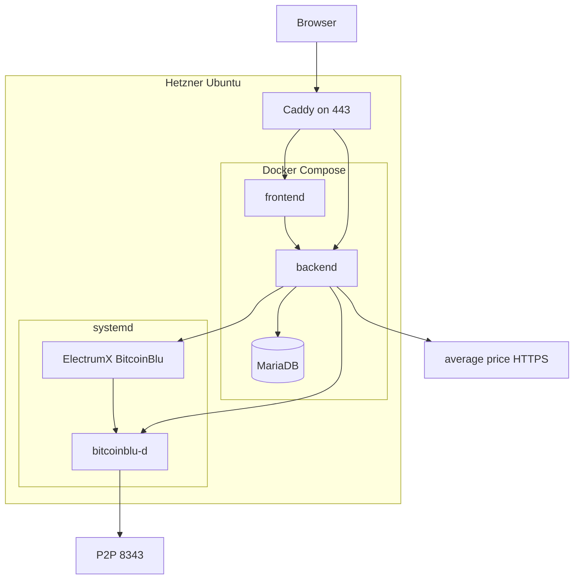

# BBLU Block Explorer — Architecture (arc42)

Status: draft for the owner. Date: 9 November 2026.
Product name: **BBLU Block Explorer**.
Source repository: <https://github.com/bitcoin-blu/bitcoinbluexplorer>.
Upstream: one-time fork of <https://github.com/mempool/mempool> (The Mempool Open Source Project, AGPL-3.0).

This document is the control surface for the system. Section 9 records each decision with an identifier. To change the architecture, name the identifier and the new choice. Open levers are collected in section 9.11 so they are not buried in prose.

Facts below come from the Bitcoin-Blu technical specification, `README-BLU.md`, `src/kernel/chainparams.cpp` in `bitcoin-blu/bitcoin-blu`, the mempool Docker and backend configuration, and `bitcoin-blu/electrumx` (`BitcoinBlu` coin class and Electrum session handlers). Chain height figures are a snapshot, not a constant.

## 1. Introduction and Goals

### 1.1 Requirements overview

BBLU Block Explorer is a public website for the Bitcoin-Blu chain (`main-blu`). A visitor can inspect the mempool, blocks, and transactions, look up addresses, broadcast a raw transaction, read fee estimates and chain charts, see a mining-pool tag on a block, and see the current BBLU average price.

The system runs on one Hetzner Ubuntu server at `167.233.207.148`, published as `blockexplorer.bitcoin-blu.org`. That server runs a full, non-pruned `bitcoinblu-d` with `txindex=1`. RPC stays on localhost. The price label is USDT.

The site is an additional public explorer. [explorer.bitcoin-blu.org](https://explorer.bitcoin-blu.org) and [bbluexplorer.codefalcon.dev](https://bbluexplorer.codefalcon.dev/dashboard.php) stay up. Replacing them is a later cutover, outside this deployment.

### 1.2 Quality goals

| Priority | Goal | What it means here |
| --- | --- | --- |
| 1 | Chain fidelity | Every page describes `main-blu`. Bitcoin addresses, Bitcoin prices, Bitcoin pool tags, and mempool.space data do not appear. |
| 2 | Owner control | Chain parameters, feature flags, pool tags, and the price source are settings or small patches in this repository. |
| 3 | Isolation | `bitcoinblu-d` RPC, ElectrumX, and MariaDB accept connections from this host only. |
| 4 | Operability | The node and the address index keep running when the website containers are rebuilt. |
| 5 | Honest scope | Lightning, Liquid, fiat history, and accelerator features are absent, and the UI does not advertise them. |

### 1.3 Stakeholders

| Role | Interest |
| --- | --- |
| Owner (you) | Decides architecture, operates the Hetzner box, accepts the fork. |
| Public visitors | Read chain data and may broadcast a transaction. |
| Bitcoin-Blu wallets | Keep using the existing public ElectrumX. This explorer does not replace that endpoint. |
| Upstream authors | AGPL-3.0 and trademark terms still apply to the forked code. |

### 1.4 Introduction

Bitcoin-Blu is a Bitcoin Core 28.2 chain with its own genesis, ports, magic, and address prefixes. Subsidy rules match Bitcoin: 50 BBLU, halving every 210,000 blocks, 21 million cap, 10-minute target.

The mempool project already implements the explorer the site needs: an Angular frontend, a Node backend, MariaDB, a Bitcoin Core RPC client, and an Electrum-protocol client for addresses. Cloning that project and pointing it at `bitcoinblu-d` is the implementation. A new explorer is out of scope.

On 9 November 2026 the public supply endpoint reported `circulating_supply` 2,946,950. At 50 BBLU per block that corresponds to height about 58,939. The node’s own comment in chainparams sizes the chain at about 2 GB. The server has 4 GB of RAM and 80 GB of local disk, so cache sizes are capped in section 7.1 and the node is synced before ElectrumX and Docker are started.

## 2. Architecture Constraints

### 2.1 Technical constraints

| Topic | Constraint |
| --- | --- |
| Consensus code | `bitcoinblu-d` / `bitcoinblu-cli` from <https://github.com/bitcoin-blu/bitcoin-blu>, based on Bitcoin Core 28.2. |
| Chain | `main-blu` only. Testnet, testnet4, signet, and regtest are not started. |
| Ports | P2P 8343. RPC 8342. |
| Magic | `0xf9beb5da`. |
| Genesis | Hash `0000000043770b6cd3992ee9602eaa941d8a5de392c1f1baf1f55eb9cd898be6`. Time `1753427181` (2025-07-25 07:06:21 UTC). Message begins `24/July/2025`. |
| Addresses | P2PKH version `0x19` (leading `B`). P2SH version `0x56` (leading `b`). Bech32 human-readable part `bb`. |
| Keys (not an explorer feature) | WIF version `0xbc` (leading `7` or `U`). Extended keys `0x0488b31f` / `0x0488afe5`. |
| Script rules that are active | BIP34, BIP65, BIP66, CSV, and SegWit heights are 0 on mainnet in `CMainParams`. |
| Taproot | The Taproot BIP9 deployment in `CMainParams` still has start 2021-04-24, timeout 2021-08-11, and `min_activation_height` 709,632. Genesis is in 2025, after that timeout. The explorer treats Taproot as inactive until chainparams change. |
| Address index | <https://github.com/bitcoin-blu/electrumx>, coin `BitcoinBlu`, network `main-blu`. |
| Explorer code | One-time fork. The pinned upstream commit is recorded in section 9.11 when the tree is imported. |
| Node storage | Non-pruned. `txindex=1`. `prune=0` is set explicitly. |
| RPC | Bound to `127.0.0.1` only. |

### 2.2 Organizational and legal constraints

The fork is AGPL-3.0. The public site offers its source at <https://github.com/bitcoin-blu/bitcoinbluexplorer>.

Mempool Holdings’ names, the mempool.space site, and the mempool logos are their trademarks. The UI, the API banner, the page title, and the footer use **BBLU Block Explorer** and a Bitcoin-Blu mark. The footer still names the upstream project and the AGPL, which is how the license is satisfied without taking the trademark.

`miningcore-blu` and `NBitcoin-blu` are examples of how a small parameter patch is applied to an upstream project. This explorer does not link either library. Pool tags are a data file (ADR-009). Address version bytes are copied into the TypeScript address tables.

### 2.3 Conventions

- Secrets live on the server, mode `0600`, and are absent from git.
- The node is the authority for “is this address valid?”. The frontend prefix check only decides whether to send the query.
- A startup check compares `getblockhash 0` with the genesis hash in section 2.1. A mismatch stops the backend.

## 3. Context and Scope

### 3.1 Business context



The public ElectrumX at `electrumx.bitcoin-blu.org` stays the wallet endpoint. This explorer runs its own ElectrumX process against the local node. The two processes share the same codebase and do not share a database.

### 3.2 Technical context

| Neighbor | Interface | Direction |
| --- | --- | --- |
| `bitcoinblu-d` | JSON-RPC on `127.0.0.1:8342` | Backend and ElectrumX call the node. |
| Local ElectrumX | Electrum protocol, TCP `127.0.0.1:50001` | Backend calls ElectrumX for address history, balance, and UTXOs. |
| BBLU P2P network | TCP `8343` | The node accepts peers. |
| Average price | HTTPS `GET https://www.bitcoin-blu.org/api/bblu/averageprice/v1/` | Backend polls the current average. |
| Visitors | HTTPS `443` on `blockexplorer.bitcoin-blu.org` (`167.233.207.148`) | Reverse proxy to the frontend and `/api`. |
| mempool.space | none | No replication, no pool list, no price history, no asset download. |

### 3.3 Scope

In the first public version:

- Mempool visualization and projected blocks, built from the local node’s mempool.
- Block and transaction pages.
- Address pages for `B…`, `b…`, and `bb1…`.
- Raw-transaction broadcast through the local node.
- Fee estimates from the local node.
- Charts the backend already computes from local blocks and the mempool (throughput, fees, mempool size).
- A mining-pool tag when the coinbase matches an entry in this repo’s pool file.
- The current average price from the endpoint above.

Out of this version:

- Lightning, Liquid, Mempool Accelerator, and any call to mempool.space.
- Testnet, signet, and regtest.
- Historical fiat charts. The average-price endpoint returns one object, not a series.
- Shutting down the other explorers.
- A public Electrum port on this box. Wallets continue to use the existing public server.

## 4. Solution Strategy

1. Import mempool once into this repository and keep the Angular frontend, the Node backend, and MariaDB.
2. Run `bitcoinblu-d` and ElectrumX under systemd on the host. Run the three mempool services in Docker. Rebuilding the website does not restart the chain.
3. Teach the frontend the BBLU address tables, the ticker, the genesis story, and the halving labels. Leave the backend’s chain reading on Bitcoin Core RPC, which `bitcoinblu-d` still speaks.
4. Treat the mempool config value `NETWORK=mainnet` as “this process’s only chain”, and make that chain `main-blu`. There is no second network to switch to.
5. Point `CORE_RPC_*` at `127.0.0.1:8342` and `ELECTRUM_*` at `127.0.0.1:50001`. Set `MEMPOOL_BACKEND=electrum`.
6. Disable every feature that would fetch Bitcoin data: Lightning, official mode, automatic pool updates, external asset servers, fiat history from a BTC feed, replication.
7. Add a BBLU pool file and a small price poller for the average-price URL.
8. Publish HTTPS for the site. Publish P2P 8343. Leave RPC, Electrum, MariaDB, and the backend port on the host.

The ElectrumX fork fits this strategy. Its `BitcoinBlu` class already carries `NET=main-blu`, RPC port 8342, the version bytes, and the genesis hash. Its session exposes the methods the mempool backend calls: `blockchain.scripthash.get_balance`, `get_history`, `listunspent`, `blockchain.transaction.get`, `get_merkle`, `broadcast`, and `mempool.get_fee_histogram`. The mempool client negotiates protocol 1.4, which this server accepts. Address indexing is by script hash, so the `bb` prefix is applied in the frontend and in `bitcoinblu-d`, and ElectrumX stores the scripts either way.

The projected-block view is computed by the mempool backend from `getrawmempool` on the node. ElectrumX is the address index. Both processes are required. Using only the public ElectrumX would couple the site to another host and would still need the local node for blocks and the mempool.

## 5. Building Block View

### 5.1 Whitebox overview



| Block | Responsibility |
| --- | --- |
| Caddy | TLS for `blockexplorer.bitcoin-blu.org`, HTTP/2, request size limits, broadcast rate limit. |
| frontend | Angular UI. Address detection, labels, ticker, navigation. |
| backend | Polls the node, serves `/api/v1`, websocket updates, broadcast, statistics. |
| MariaDB | Backend cache and statistics. Disposable relative to the chain. |
| `bitcoinblu-d` | Chain, mempool, fee estimates, `validateaddress`, `sendrawtransaction`, `getrawtransaction`. |
| ElectrumX | Script-hash history for address pages. |

### 5.2 Level 2 — backend configuration

These are the values that make the unmodified backend speak to this chain. Names match `mempool-config.json` and the Docker environment overrides.

| Key | Value |
| --- | --- |
| `MEMPOOL.NETWORK` | `mainnet` (means `main-blu` in this fork) |
| `MEMPOOL.BACKEND` | `electrum` |
| `MEMPOOL.OFFICIAL` | `false` |
| `CORE_RPC.HOST` / `PORT` | host gateway / `8342` |
| `ELECTRUM.HOST` / `PORT` / `TLS_ENABLED` | host gateway / `50001` / `false` |
| `LIGHTNING.ENABLED` | `false` |
| `STATISTICS.ENABLED` | `true` |
| `FIAT_PRICE.ENABLED` | replaced by the BBLU average-price poller; the UI labels the figure USDT |
| `MEMPOOL.AUTOMATIC_POOLS_UPDATE` | `false` |
| `MEMPOOL.POOLS_JSON_URL` | a file in this repo, served locally |
| `EXTERNAL_DATA_SERVER.*` | empty |
| `REPLICATION.ENABLED` | `false` |
| `MEMPOOL_SERVICES.ACCELERATIONS` | `false` |
| `MEMPOOL.BLOCK_WEIGHT_UNITS` | `4000000` (unchanged; the weight limit was not redefined) |

Docker reaches the host through `host.docker.internal` with `extra_hosts: ["host.docker.internal:host-gateway"]`. That is the Linux form of the host address ElectrumX’s own setup notes call `172.17.0.1`.

### 5.3 Level 2 — fork inside the mempool tree

Config cannot express BBLU addresses. The frontend tables are Bitcoin’s. These are the code points a one-time fork changes. Line references are mempool `master` as of 9 November 2026 and will move; the file names are the stable part.

| File | Change |
| --- | --- |
| `frontend/src/app/shared/address-utils.ts` | `mainnet` prefixes: pubkey `B`, script `b`, bech32 `bb1`. Detect `bb1` before a lone leading `b`, or every native-segwit address is classified as P2SH. |
| `frontend/src/app/shared/regex.utils.ts` | `mainnet` base58 character class and `bc1` / `BC1` become `B` / `b` and `bb1` / `BB1`. |
| `frontend/src/app/bitcoin.utils.ts` | `featureActivation.mainnet`: `rbf` 0, `segwit` 0. Taproot stays inactive (section 2.1). |
| `frontend/src/app/app.constants.ts` | `specialBlocks`: genesis label for Bitcoin-Blu; halving heights stay 210,000 × n and the unit becomes BBLU. Remove the Bitcoin Taproot banner at height 709,632. |
| Price service and backend fiat task | Poll the average-price URL. Show `average_price` with the label USDT. The JSON still has no currency field; USDT is this site’s label (ADR-008). |
| Navigation, titles, assets | Product name BBLU Block Explorer. Hide Lightning and Liquid routes. |
| Pool loader | Read the local BBLU pool file. |

The backend address path calls `validateaddress` on the node and then Electrum script-hash methods (`backend/src/api/bitcoin/electrum-api.ts`). Once `bitcoinblu-d` accepts `B`, `b`, and `bb1`, that path follows the node. The frontend gate above is what would otherwise reject the address in the browser.

`bitcoinblu-d` remains the authority. A prefix match that the node rejects is shown as invalid.

### 5.4 Level 2 — node and ElectrumX

`bitcoinblu.conf` on the server:

```ini
server=1
txindex=1
prune=0
chain=main
rpcbind=127.0.0.1
rpcallowip=127.0.0.1
rpcport=8342
rpcauth=<generated on the server>
dbcache=512
maxmempool=64
```

`dbcache=512` and `maxmempool=64` are the steady-state values for 4 GB of RAM. During the first sync, stop ElectrumX and Docker and raise `dbcache` to `1024`, then put it back to `512` before those services start. A 2 GB swap file is there so a sync spike is swapped instead of killing the node.

`chain=main` selects `CMainParams`, whose port, magic, genesis, and prefixes are already the Blu values. The chain name reported by the node is `main-blu`.

ElectrumX environment:

```bash
COIN=BitcoinBlu
NET=main-blu
DAEMON_URL=http://<rpcauth-user>:<rpcauth-password>@127.0.0.1:8342/
SERVICES=tcp://127.0.0.1:50001
DB_DIRECTORY=/var/lib/electrumx
DB_ENGINE=leveldb
CACHE_MB=256
```

`CACHE_MB=256` replaces the upstream example of 1200 so ElectrumX fits beside the node on 4 GB. Raise it only after measuring free memory with the full stack up.

ElectrumX `transaction.get` calls `getrawtransaction`, which is why `txindex=1` is mandatory.

## 6. Runtime View

### 6.1 New block

1. A peer delivers a block to `bitcoinblu-d` on port 8343.
2. The backend’s poll (default 2 seconds) sees a new tip through RPC.
3. The backend stores the summary in MariaDB and pushes it on the websocket.
4. The frontend redraws the latest blocks.
5. ElectrumX follows the same tip over RPC and updates script-hash history. Address pages do not wait for a separate import job beyond ElectrumX’s own sync.

### 6.2 Address lookup

1. The visitor submits an address. The frontend accepts it only when it matches `bb1`, or a base58 string starting with `B` or `b`, with `bb1` tested first.
2. The backend calls `validateaddress` on `bitcoinblu-d`.
3. On success it hashes the script and calls ElectrumX `blockchain.scripthash.get_history` and `listunspent`.
4. Transaction bodies come from `getrawtransaction` on the node.
5. The page renders confirmed and mempool rows.

A WIF (`0xbc`, leading `7` or `U`) is rejected in the browser and is not written to the access log.

### 6.3 Broadcast

1. The visitor posts a raw transaction to the API.
2. Caddy applies a rate limit and a body-size limit.
3. The backend calls `sendrawtransaction` on the local node.
4. The node relays the transaction on P2P if it accepts it.

### 6.4 Price and pool tags

The backend polls the average-price URL about once a minute and caches the latest `average_price` and `timestamp`. The UI prints that number as USDT. A failed poll keeps the previous value and surfaces the timestamp so a stale price is visible.

On each block, the backend compares the coinbase script with the local pool file and stores the tag. An unknown coinbase is “unknown”, which is the honest result for a pool file that starts small.

### 6.5 Startup gate

Before the backend serves traffic it checks:

- RPC `getblockhash 0` equals `0000000043770b6cd3992ee9602eaa941d8a5de392c1f1baf1f55eb9cd898be6`.
- `getblockchaininfo` reports chain `main-blu` and `pruned: false`.
- ElectrumX `server.version` answers on `127.0.0.1:50001` and its tip is within a few blocks of the node.

`chainparams.cpp` still contains checkpoint hashes at heights 11,111, 33,333, and 48,500. If initial sync stops near one of those heights, the checkpoint list is the first place to look. The explorer does not paper over a node that is stuck.

## 7. Deployment View

### 7.1 Infrastructure

One Hetzner Ubuntu VM. Quoted cost 6.52 per month, with 20 TB of outbound traffic included.

| Resource | Value |
| --- | --- |
| Hostname | `blockexplorer.bitcoin-blu.org` |
| DNS | `A` record to `167.233.207.148`. No IPv6 address was given, so the site is IPv4 only until an `AAAA` record exists. |
| vCPU | 2 |
| RAM | 4 GB |
| Disk | 80 GB local |
| OS | Ubuntu 24.04 LTS, or the release already installed (L3). |

Caddy requests a certificate for `blockexplorer.bitcoin-blu.org` after that `A` record points at `167.233.207.148`.

Steady-state memory on 4 GB:

| Process | Cap |
| --- | --- |
| `bitcoinblu-d` | `dbcache=512`, `maxmempool=64` |
| ElectrumX | `CACHE_MB=256` |
| MariaDB | `innodb_buffer_pool_size=256M` |
| backend, frontend, Caddy, OS | the rest, with a 2 GB swap file |

Disk budget on 80 GB: the chainparams size estimate is about 2 GB of blocks and 1 GB of state. Leave at least 20 GB free after the OS, Docker images, MariaDB, and one ElectrumX directory. That is enough for years at the current chain size, and enough to rebuild ElectrumX beside the live index. Sync the node to the tip before starting ElectrumX or the explorer containers, so IBD and the first address index do not run together.

### 7.2 Processes

| Unit | Supervisor | Listens |
| --- | --- | --- |
| `bitcoinblu-d` | systemd | `8343` all interfaces, `8342` localhost |
| ElectrumX | systemd, after the node | `127.0.0.1:50001` |
| MariaDB, backend, frontend | Docker Compose, restart unless stopped | backend `127.0.0.1:8999`, frontend behind Caddy |
| Caddy | systemd | `80`, `443` |

Node data: `/var/lib/bitcoinblu`. ElectrumX data: `/var/lib/electrumx`. Docker volumes for MariaDB and the backend cache live under `/var/lib/bblu-explorer`.

### 7.3 Firewall

| Port | Exposure |
| --- | --- |
| 22 | Admin addresses only. |
| 80, 443 | Public. |
| 8343 | Public, so this node is a peer. Close it if the box should not be a public peer. |
| 8342, 50001, 3306, 8999 | Host only. |

### 7.4 Build and release

The one-time fork lives in this git repository. Images for the frontend and backend are built from that tree and tagged with the git revision. The server pulls a tag. `bitcoinblu-d` and ElectrumX are installed from their own repositories and upgraded on their own cadence, because a website release must not be the only way to patch the node.

Rollback of the website is the previous image tag. Rollback does not touch `/var/lib/bitcoinblu` or `/var/lib/electrumx`.

## 8. Cross-cutting Concepts

### 8.1 Chain identity

One genesis hash, one ticker (BBLU), one address family. UI strings that say Bitcoin or BTC are part of the fork work, including halving captions in `specialBlocks`.

### 8.2 Persistence

The chain on disk is the source of truth. MariaDB and the backend cache can be deleted and rebuilt by replaying RPC. ElectrumX can be reindexed from the node. Backups that matter are the node directory and the server secret file. A daily copy of `/var/lib/bitcoinblu` is enough for a chain this size. The explorer database is not backed up as chain data.

### 8.3 Security

- RPC authentication is `rpcauth` generated on the server.
- Docker reaches RPC through the host gateway. `rpcallowip` includes that gateway address and no public range. If the gateway is not `127.0.0.1`, the bind address stays a private interface, and the firewall still drops 8342 from the internet.
- ElectrumX is not published. Wallet users stay on the existing public server.
- Broadcast is rate-limited. The body limit stays at the mempool default of one block weight.
- Search input that looks like a private key is dropped before it is logged.
- TLS certificates come from Caddy’s ACME client for `blockexplorer.bitcoin-blu.org`.
- SSH is key-based.

### 8.4 Observability

systemd status for the node and ElectrumX, Docker healthchecks for the three explorer services, and Caddy access logs. The backend log line that records the Electrum `server.version` banner is the check that the index is the Blu build. A public status page is optional and not required for launch.

### 8.5 Internationalization

The upstream UI ships many languages. English is the maintained language for BBLU-specific strings. Other locales keep upstream translations until a string is changed, in which case the English text is the source.

## 9. Architecture Decisions

Each decision is accepted for this draft. The “Switch” column is the supported way to change it.

### ADR-001 — One-time fork of mempool

- Status: accepted.
- Decision: import <https://github.com/mempool/mempool> once into <https://github.com/bitcoin-blu/bitcoinbluexplorer>. Product name BBLU Block Explorer. Publish source with the site.
- Why: the UI and the API already exist, and the chain speaks Bitcoin Core RPC.
- Switch: a later upstream merge is a new decision. This draft does not track master continuously.
- Consequence: security fixes from upstream are adopted by hand. The imported commit is written into section 9.11 at import time.

### ADR-002 — `mainnet` in the fork means `main-blu`

- Status: accepted.
- Decision: keep `MEMPOOL.NETWORK=mainnet` and the frontend network id `mainnet`. Change that profile’s prefixes, labels, and feature heights to BBLU. Do not add a network switcher.
- Why: testnet, signet, regtest, and Liquid are not part of this deployment. A new network id would touch every `switch (network)` in the tree.
- Switch: add a real `main-blu` id if a second chain ever has to run in the same process.

### ADR-003 — One VM, split supervisors

- Status: accepted.
- Decision: one Hetzner Ubuntu VM. systemd runs `bitcoinblu-d` and ElectrumX. Docker Compose runs frontend, backend, and MariaDB.
- Why: a frontend rebuild must not restart the chain. ElectrumX already documents a `BitcoinBlu` environment, and the node has no reason to live inside the mempool compose file.
- Switch: move ElectrumX into Compose using that project’s Docker files if you would rather upgrade it with the website. The node stays on systemd either way.

### ADR-004 — Local ElectrumX as the address index

- Status: accepted.
- Decision: run <https://github.com/bitcoin-blu/electrumx> on this server with `COIN=BitcoinBlu` and `NET=main-blu`, talking to local RPC. The mempool backend uses `MEMPOOL_BACKEND=electrum`.
- Why it fits: the coin class matches chainparams, and the server implements the Electrum methods this backend calls, including `mempool.get_fee_histogram`. Protocol 1.4 is inside its supported range.
- Why local: the public host `electrumx.bitcoin-blu.org` remains the wallet endpoint. The explorer’s index shares fate with the node it is displaying.
- Switch: point `ELECTRUM_HOST` at the public server if you want a thinner box. Address pages then depend on that host’s availability and limits. The local node is still required for blocks and the mempool.

### ADR-005 — Full node, private RPC

- Status: accepted.
- Decision: non-pruned `main-blu`, `txindex=1`, `prune=0`, RPC on localhost port 8342, P2P on 8343.
- Why: ElectrumX and the backend both use `getrawtransaction`. A pruned node cannot answer it for arbitrary history.
- Switch: none for prune or txindex while address pages and transaction pages are in scope.

### ADR-006 — First version feature set

- Status: accepted.
- In: mempool view, blocks, transactions, addresses, broadcast, fee estimates, local charts, pool tags, current average price.
- Out: Lightning, Liquid, accelerator, mempool.space, historical fiat, other networks, retiring the other explorers.
- Switch: name the feature. Historical fiat needs a price series that the current API does not provide.

### ADR-007 — No Bitcoin data feeds

- Status: accepted.
- Decision: `OFFICIAL=false`, replication off, automatic pool update off, external data server URLs empty, Lightning off.
- Why: those feeds describe Bitcoin. Leaving the defaults on would label BBLU blocks with Bitcoin pools and Bitcoin prices.
- Switch: only for a feed that is actually about BBLU.

### ADR-008 — Live average price only

- Status: accepted.
- Decision: display `average_price` and `timestamp` from `https://www.bitcoin-blu.org/api/bblu/averageprice/v1/`, labeled **USDT**. The upstream BTC fiat history stays unused.
- Why: the payload is one object. On 9 November 2026 it contained per-exchange fields and `average_price`, and no currency field. USDT is the label you set for that number.
- Switch: change the label if the API’s quote asset changes. Add history when an endpoint returns a series.

### ADR-009 — Pool tags are data in this repo

- Status: accepted.
- Decision: a JSON file in this repository maps coinbase tags to pool names. `miningcore-blu` is the likely producer of those tags. Unknown coinbases stay unknown.
- Why: the upstream pool list is the Bitcoin pool directory.
- Switch: edit the file. An empty file is a valid launch state.

### ADR-010 — Additional explorer

- Status: accepted.
- Decision: this site does not replace `explorer.bitcoin-blu.org` or `bbluexplorer.codefalcon.dev`. DNS cutover is a later change.
- Switch: when you want the cutover, point the existing hostname at this Caddy and keep the old process until the genesis check on this box matches what users already see.

### ADR-011 — SegWit on, Taproot off in the UI

- Status: accepted, bound to current chainparams.
- Decision: show SegWit as active from height 0. Do not show Taproot as active. Do not celebrate height 709,632 as an activation that already happened on BBLU.
- Why: `CMainParams` sets `SegwitHeight = 0`. The Taproot deployment times out in August 2021 and cannot activate before height 709,632. Genesis is July 2025.
- Switch: if `bitcoin-blu` chainparams enable Taproot, set the activation height in `bitcoin.utils.ts` to that height and restore a special-block label.

### ADR-012 — Hostname, address, and server size

- Status: accepted.
- Decision: public name `blockexplorer.bitcoin-blu.org`, `A` record to `167.233.207.148`. The machine is 2 vCPU, 4 GB RAM, 80 GB local disk, 20 TB outbound included, quoted at 6.52 per month.
- Why: that is the server you allocated. Cache caps in section 7.1 are what make the explorer fit in 4 GB.
- Switch: a larger plan relaxes `dbcache`, `CACHE_MB`, and the MariaDB pool. The hostname change is a DNS and Caddy edit.

### 9.11 Open levers

| ID | Lever | Working default |
| --- | --- | --- |
| L3 | Ubuntu release | 24.04 LTS, or whatever is already installed. |
| L5 | Pool file contents | empty at launch. |
| L6 | Publish P2P 8343 | yes. |
| L7 | Upstream commit imported | filled in when the mempool tree is copied. |
| L8 | ElectrumX git revision | filled in at install. Must be the `bitcoin-blu/electrumx` revision that contains the `BitcoinBlu` class. |

## 10. Quality Requirements

| Scenario | Stimulus | Response |
| --- | --- | --- |
| Genesis | Backend starts against a node on the wrong chain. | Process stays unhealthy. No pages are served. |
| Address | Visitor opens a `bb1…` address, a `B…` address, and a `b…` address that the node accepts. | Each page loads history from ElectrumX. |
| Rejection | Visitor submits a Bitcoin `bc1…` or `1…` address. | The UI rejects it. The node is not asked to treat it as BBLU. |
| Privacy of keys | Visitor pastes a WIF. | The UI refuses it. The value is absent from logs. |
| Isolation | A scan of the public addresses hits 8342, 50001, and 3306. | Those ports do not answer. |
| Broadcast abuse | A client floods raw transactions. | Caddy limits the rate. Accepted transactions are the node’s decision. |
| Index lag | ElectrumX is more than a handful of blocks behind the node. | Address pages show the index height. The homepage still follows the node tip. |
| Price outage | The average-price URL fails. | The last value remains, with its old timestamp. |
| Rebuild | Frontend image is replaced. | `bitcoinblu-d` and ElectrumX are not restarted. |
| License | A visitor looks for source. | The footer links to this repository. |
| Labels | Any chart, halving caption, title, or price. | The asset is BBLU. The price unit is USDT. Taproot is not described as active. |

## 11. Risks and Technical Debt

| Risk | What we do about it |
| --- | --- |
| One-time fork misses an upstream security fix. | Record the imported commit (L7). Review upstream releases before each public deploy. |
| Frontend prefix order treats `bb1` as P2SH. | Test `bb1` first. Covered by the address scenario in section 10. |
| Taproot chainparams get edited and the UI stays wrong, or the reverse. | ADR-011 names the chainparams fields. A node upgrade includes a check of those three deployment fields. |
| Bitcoin checkpoints in `chainparams.cpp` halt sync around height 11,111, 33,333, or 48,500. | Startup is judged by height versus the supply endpoint, not only by process-up. A stuck node is fixed in `bitcoin-blu` before the explorer is announced. |
| mempool `master` expects an RPC that Core 28.2 does not have. | First integration run is a logged RPC pass against the synced node. Missing calls are patched in the fork or avoided by disabling the feature that needs them. |
| ElectrumX `TX_COUNT` constants in the coin class are a February 2026 snapshot and are stale. | They affect ElectrumX’s internal estimates. Reindex still walks the real chain. Update them if the server logs warn about them. |
| Empty pool file makes every block “unknown”. | Acceptable at launch (L5). Tags appear as you add rows. |
| The price API has no currency field. | The UI always says USDT, because that is the declared quote (ADR-008). If an exchange in `sources` is quoted in something else, the average is still labeled USDT until you change ADR-008. |
| First sync on 4 GB. | Node sync runs alone, with `dbcache=1024` and a 2 GB swap file. ElectrumX and Docker start afterward at the steady-state caps in section 7.1. |
| Public broadcast is abused. | Rate limit, body limit, and the node’s own mempool policy. |
| AGPL site without a source link. | Footer link is a launch check. |
| Two explorers disagree. | This one is additional (ADR-010). Disagreements are debugged against the local node, which is the reference. |

## 12. Glossary

| Term | Meaning |
| --- | --- |
| BBLU | Ticker of Bitcoin-Blu. |
| `main-blu` | The only running Bitcoin-Blu chain. |
| `bitcoinblu-d` | Full node binary. |
| mempool project | Upstream explorer at github.com/mempool/mempool. In this fork its `mainnet` profile is BBLU. |
| ElectrumX | The Python Electrum server forked at github.com/bitcoin-blu/electrumx. |
| Script hash | Reverse SHA256 of a scriptPubKey. ElectrumX’s address key. |
| Projected blocks | The backend’s fee-grouped picture of the mempool, built from the node. |
| Average price | Latest value from the bitcoin-blu.org average-price API, shown as USDT. |
| Open lever | A choice left to the owner, listed in section 9.11. |
